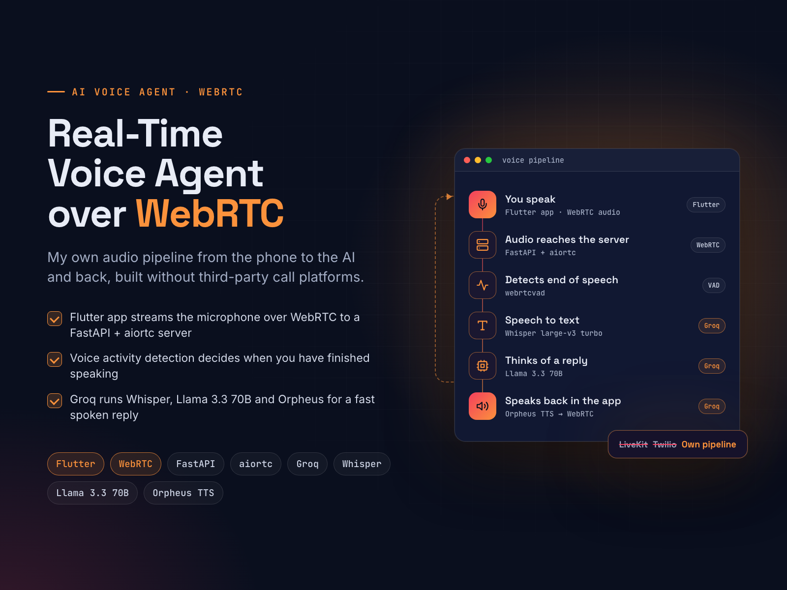

# Real-Time AI Voice Agent over WebRTC

**Flutter, FastAPI, Groq**

**Goal:** a fast voice assistant without paying for LiveKit or Twilio.

**Solution:** the Flutter app streams the microphone over WebRTC to my own FastAPI + aiortc server. Voice activity detection finds the end of each sentence. Groq then runs Whisper large-v3 turbo for speech-to-text, Llama 3.3 70B for the reply and Orpheus for the voice, and the audio streams back over the same WebRTC connection.

**Result:** a self-hosted voice pipeline with no call-platform fees, where any step (STT, LLM or TTS) can be swapped for another provider.

| | |
|---|---|
| **My role** | Solo developer: WebRTC pipeline, FastAPI server and Flutter client |
| **Skills** | WebRTC, Python, AI Agent Development, AI Text-to-Speech, Flutter |

## About this repository

This is a showcase repository. It contains the project poster and the poster's own HTML/CSS source in [`poster/`](poster/).
The app's source code is kept private.

To re-render the poster, open `poster/index.html` in Chrome at 1600×1200, or run `poster/render.sh` on macOS.

More of my work: **https://ahsanrazapk.github.io**
